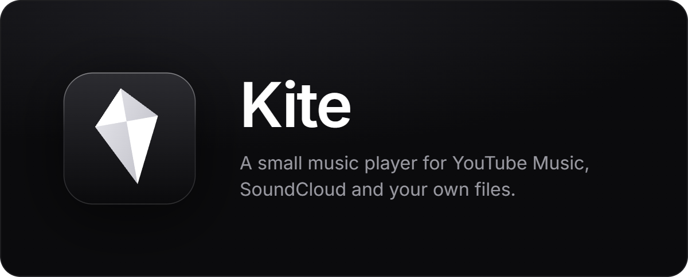
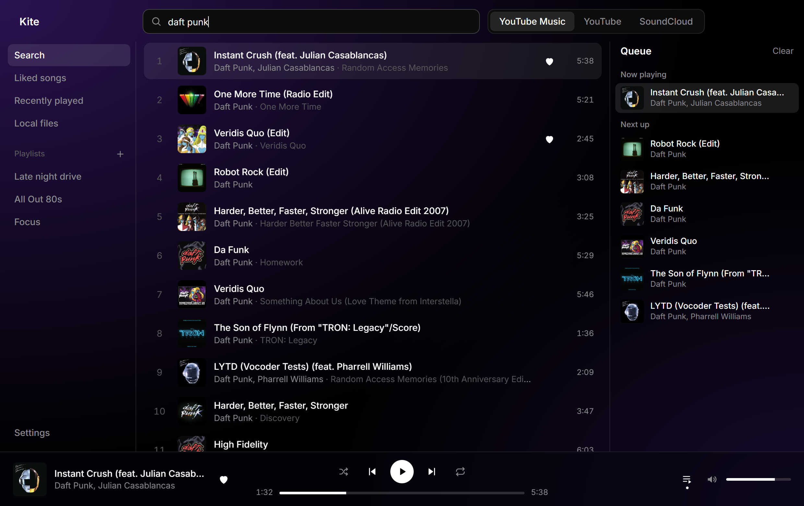
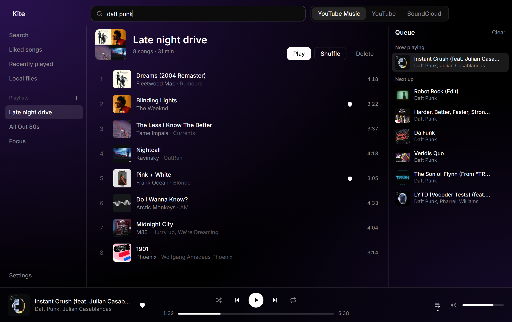

<div align="center">

# Kite

**Small, open-source music player for YouTube Music, YouTube, SoundCloud, and local files.**

[](https://github.com/rockslol/kite/releases) [](https://github.com/rockslol/kite/releases) [](https://github.com/rockslol/kite/releases) [](https://github.com/rockslol/kite/releases/latest) [](./LICENSE)

[Overview](#overview) • [Features](#features) • [Screenshots](#screenshots) • [Architecture](#architecture) • [Getting Started](#getting-started) • [Building](#building) • [macOS Notes](#macos-notes) • [Contributing](#contributing) • [License](#license)

<br/>



</div>

---

## Overview

Kite is a desktop music player for Windows and macOS. It streams from YouTube Music, YouTube, and SoundCloud, plays your own music files, and brings in your playlists from Spotify and Deezer.

It's built with Tauri, so it uses the webview Windows already has instead of shipping its own browser: a 3.5 MB installer, about 160 MB of memory while playing, and almost no CPU in the tray.

No account. No ads. No tracking or telemetry.

**[Download the latest release](https://github.com/rockslol/kite/releases/latest)**. Kite updates itself when a new version comes out.

---

## Features

- **Streaming & local**: Search YouTube Music, YouTube, and SoundCloud from one box, paste any link to play it, or add music folders (MP3, FLAC, M4A, OGG, Opus, WAV) with their tags and cover art.
- **Playlist import**: Bring public playlists, albums, and songs from Spotify, Deezer, YouTube Music, YouTube, and SoundCloud. Spotify and Deezer songs are matched to the same song on YouTube Music, avoiding live, cover, and sped-up versions. **Sync** adds songs that are new at the source.
- **Pick another version**: If a match is wrong, right-click it and choose another. Kite remembers your choice for the next import.
- **Library**: Liked songs, playlists you can rename and reorder by dragging, Recently played, and Most played.
- **Queue**: Play next, add to queue, drag to reorder, shuffle, and repeat. Your queue and position are still there after a restart.
- **Synced lyrics**: Line-by-line lyrics from [LRCLIB](https://lrclib.net) or a `.lrc` file next to a local song, with the current line kept in view. Click a line to jump there, and nudge the timing if it's early or late.
- **Sound**: One-click effects (Slowed + reverb, Nightcore, 8D…), speed and pitch, reverb, a 10-band equalizer, balance and mono, a sleep timer, crossfade that can wait for a song's quiet ending, and even-out volume. Pick which speakers or headphones Kite plays on; each keeps its own volume and equalizer.
- **Sharing**: Show what you're playing as your Discord status, and scrobble to Last.fm or ListenBrainz with your own account. All off until you switch them on.
- **Shortcuts everywhere**: Play, pause, skip, like, and show Kite from any app, with keys you choose.
- **System integration**: Media keys, the Windows media controls and volume flyout, a tray icon with playback controls, and start with Windows.
- **Light by design**: Closing the window keeps the music playing in the tray, where Kite stops drawing its interface entirely.
- **Always working**: Kite downloads [yt-dlp](https://github.com/yt-dlp/yt-dlp) on first run, checks it against the official checksums, and keeps it updated by itself, so site changes don't need a new Kite release.

---

## Screenshots

<div align="center">

<br/><br/>

</div>

---

## Architecture

Kite is a Tauri 2 app: a Rust backend and a Svelte 5 interface. Audio and covers reach the interface through Kite's own `kite://` protocol, so no local web server is opened.

```
kite/
├── src/                        # Interface (Svelte 5)
│   ├── App.svelte              # Layout, search bar, keyboard shortcuts
│   ├── lib/
│   │   ├── player.svelte.js    # Playback, queue, shuffle and repeat, session restore
│   │   ├── library.svelte.js   # Liked songs, playlists, music folders
│   │   ├── importer.svelte.js  # Playlist import progress and sync
│   │   ├── TrackList.svelte    # Song lists with likes, menus, and drag and drop
│   │   ├── PlayerBar.svelte    # Now playing and controls
│   │   ├── QueuePanel.svelte   # Up next
│   │   └── Sidebar.svelte      # Navigation and playlists
│   └── views/                  # Search, Liked songs, Recently played, Local files, Playlist, Settings
├── src-tauri/                  # Backend (Rust)
│   └── src/
│       ├── main.rs             # App setup and kite:// routing
│       ├── ytdlp.rs            # yt-dlp and JS runtime: download, verify, update, search, resolve
│       ├── stream.rs           # Audio streaming with range requests, saved stream links, an HLS cache
│       ├── ytmusic.rs          # YouTube Music search and song matching
│       ├── import.rs           # Spotify, Deezer, YouTube, and SoundCloud imports
│       ├── library.rs          # SQLite library: likes, playlists, history
│       ├── local.rs            # Music folder scanner (tags and artwork)
│       ├── watch.rs            # Watches music folders for changes while Kite runs
│       ├── backup.rs           # Library export and import
│       ├── log.rs              # Local log file for "Copy debug info"
│       ├── media.rs            # System media controls
│       ├── titles.rs           # Cleans YouTube titles into song and artist
│       └── app.rs              # Settings, tray, updates, cache
├── release/publish.py          # Publishes a release to GitHub
├── CHANGELOG.md                # What changed in each version
├── CONTRIBUTING.md             # How to help
├── docs/                       # README images
└── LICENSE
```

YouTube needs a JavaScript runtime. Kite uses Deno or Node.js if you have one, and otherwise downloads [QuickJS](https://github.com/quickjs-ng/quickjs) (about 2 MB, checked against a fixed checksum). Kite never streams from Spotify or Deezer.

---

## Getting Started

### Prerequisites

- **Node.js** `20+`
- **Rust** (stable)
- On Windows, the **Visual Studio C++ Build Tools**

---

### Setup

```bash
git clone https://github.com/rockslol/kite.git
cd kite
npm install
```

---

### Running in Development

```bash
npm run tauri dev
```

---

## Building

```bash
# Build an installer for your current OS (output goes to src-tauri/target/release/bundle/)
npm run tauri build
```

Pre-built installers for Windows and macOS are available on [Releases](https://github.com/rockslol/kite/releases).

---

## macOS Notes

macOS builds are made with the GitHub Actions workflow in `.github/workflows/build.yml` (a universal app for Apple Silicon and Intel). They aren't notarized yet. If Gatekeeper blocks Kite on first launch:

1. Right-click `Kite.app` in `/Applications`, click **Open**, and confirm. On macOS 15+, open **System Settings → Privacy & Security** and select **Open Anyway**.
2. If macOS reports the app as damaged, run:
   ```bash
   xattr -cr /Applications/Kite.app
   ```

---

## Contributing

Contributions are welcome: bug reports, ideas, and pull requests. For bigger changes, open an issue first so we can talk it through. See [CONTRIBUTING.md](./CONTRIBUTING.md) for setup and what to check before opening a pull request, and [CHANGELOG.md](./CHANGELOG.md) for what changed in each version.

---

## License

Distributed under the [MIT License](./LICENSE).
